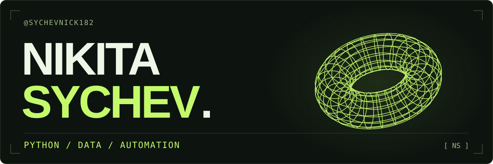

 

&nbsp;&nbsp;
&nbsp;&nbsp;

 

### Привет, я Никита.

Разрабатываю на **Python**: веб-сервисы, API, ботов и интеграции.
Работаю с данными и автоматизирую рутину.

- **Backend** — FastAPI, Django, REST и интеграции между сервисами.
- **Данные** — SQL, PostgreSQL, анализ и применение нейросетей.
- **Frontend** — создаю интерфейсы с помощью AI.

 

### Стек

&nbsp;&nbsp;
&nbsp;&nbsp;
&nbsp;&nbsp;
&nbsp;&nbsp;

&nbsp;&nbsp;
&nbsp;&nbsp;
&nbsp;&nbsp;
&nbsp;&nbsp;

 

> Этот аккаунт — дублёр моего профиля [nikita-sychev182 на GitHub](https://github.com/nikita-sychev182). Здесь размещены перенесённые копии моих репозиториев.

Активность на GitHub

 

